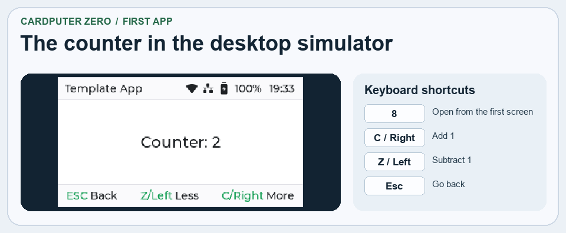

<h1 align="center">Building Apps for the M5Stack Cardputer Zero</h1>

A community guide for building many kinds of applications on the **CardputerZero
Linux handheld**: utilities, notes, games, networking tools, media and peripheral
apps. Start with official foundations, choose only the facilities your app needs,
and preserve useful lessons from real projects.

## Scope and starting point

This guide targets the CardputerZero's Debian arm64/APPLaunch environment. The
original ESP32 Cardputer and Cardputer ADV need different firmware, input and
packaging instructions. Hardware/image variants can differ; document your tested
profile and probe capabilities instead of assuming every device has a camera or Cap.

No radio, Python backend, local socket or background service is required by the
guide. C++/LVGL with the official Template is the main native UI recipe. Other
languages/toolkits can follow the same launcher, keyboard, privacy and package
contracts with their own rendering/build implementations.

## Start here

New to this device? **[Build your first app](docs/first-app.md)** in the desktop
simulator. You don't need a Cardputer Zero for this first build. Start with the
[short route](docs/start-here.md) if you want to see what to read and what to skip.

*Open the counter with **8**, try **C/Right** and **Z/Left**, then press
**Esc** to go back. Once it works, change the greeting and add your own reset
action. Simulator capture: [official Template, M5Stack CardputerZero Community
(MIT)](https://github.com/CardputerZero/Template/blob/477fa6d217b683e3084c361a757f03dc8ca9f753/LICENSE);
annotations added.*

Returning with a specific task? Use the [project selector](docs/projects/README.md).
Use the chapters below as a reference. Library decisions and historical Mesh
lessons are separate resources further down this page.

## Common foundation

| Read | Covers |
|---|---|
| [1. Platform](docs/01-platform.md) | Device constraints, Debian, launcher and Store |
| [2. App anatomy](docs/02-app-anatomy.md) | Package layout, launcher entry, privileges and resource ownership |
| [3. Architecture choices](docs/03-architecture.md) | A single process, workers or a separate resource-owning service |
| [4. UI and polish](docs/04-ui-and-polish.md) | Navigation, accessibility, overlays, settings, progress and performance |
| [5. Keyboard](docs/05-keyboard.md) | Official map, text/navigation context, modifiers and event-path tests |
| [6. Building and packaging](docs/06-building-and-packaging.md) | Native/Python paths, dependencies, arm64 builds and installed checks |
| [8. Security, licensing and publishing](docs/08-security-and-publishing.md) | Threat boundaries, private data, attribution and release evidence |

For deeper background, read 1, 2 and 3. Then choose the UI/build path and
[project sections](docs/projects/README.md) that apply. Chapter numbers and paths
are retained for existing links; [7. LoRa bring-up](docs/07-radio-bring-up.md) is optional.

## Optional project sections

The [project selector](docs/projects/README.md) covers local utilities, persistent
text/messaging, [GPS/maps](docs/projects/gps-and-maps.md), camera/QR, NFC/other hardware, networked apps and audio/media.
Each section distinguishes transferable patterns, actual examples and qualification
still required for a new app. A radio antenna rule does not become a calculator
requirement; a camera example does not certify every image's camera stack.

## Official foundations and focused contributions

Use the [component comparison](docs/components.md) to see what the official
Template, launcher/shared SDK and AppBuilder already provide, where our Mesh code
is specific to that app, and which gaps are worth addressing upstream.

The first [prepared keyboard contribution](contributions/template-keyboard/README.md)
adds the official symbol map, full text input, an optional editor example and
raw-event/editor tests to a pinned official Template. It is a reviewable proposal,
not an accepted upstream release or a new general framework.

## Personal reusable library

The [UI preference record](docs/ui-preferences.md) tracks the owner's decisions:
the exact Mesh home carousel and Mesh list-selection base are confirmed;
submenu chevrons and overflow indicators are specified. Other components remain open.

Our [library principles](docs/library-principles.md) record the preferences and
design choices we want to reuse across our own apps, including appearance,
interaction, application logic and backend organization. They complement official
foundations and distinguish personal choices, useful alternatives and demonstrated
improvements. Each meaningful departure is discussed before deciding what to keep
or share. These choices remain separate from the general guide's platform requirements.

The [source inventory and proposed version 0.1 scope](docs/library-inventory.md)
compare Mesh, Surveyor and NFC Tools, with file hashes, extraction candidates,
open preferences and licensing/qualification boundaries.
The [official keyboard/input evaluation](docs/official-input-evaluation.md)
records the first use/adapt decision: official shared input for that runtime,
with a focused Template extension considered separately.
The [official UI/shell evaluation](docs/official-ui-evaluation.md) records the
next decision: reuse official foundations and adapt presentation to our preferences,
preserving lifecycle, input and backend ownership.

## M5Stack engineering review package

The [prepared report and review package](submissions/m5stack-2026-11-16/README.md)
explain the improvements, exact sources, tests, licenses and remaining checks,
including Mesh's deliberate modular UI/supervisor design. The package is prepared
for review; no upstream PR, Store submission or new general library is implied.

## Worked examples and preserved learning

The [first counter walkthrough](docs/first-app.md) is the small starting example.
The [independent-reader check](docs/first-reader-check.md) records how to test the
guide without our chat context; that check is still pending.

Mesh contributed many lessons, but it is one application. The
[Mesh case study](docs/case-studies/mesh.md) retains detailed state, privacy,
conversation, camera and licensing examples with pinned implementation/evidence.
The [lesson index](docs/lesson-index.md) explains where those lessons now live.
The earlier guide remains available through its linked Git revision.

Keep [source-level tests](docs/components.md#evidence-and-limits), container checks,
actual-device qualification and Store admission separate. No test count guarantees
security, hardware compatibility or approval for a different application.

## Release and contribution checks

Use the [Store readiness checklist](docs/store-readiness.md) and
[offline preflight tool](tools/README.md) to inspect a listing and its actual installer
without authentication, upload or submission. Official policy/catalog revisions are
pinned and reviewed; a passing local report is not a Store acceptance.

Corrections, focused examples and tested improvements are welcome. Prefer reusing
or contributing to official components. Consider a separate library only after
recurring needs or shared preferences, two unrelated consumers and a
maintenance/compatibility plan justify it.

## Offline reading edition

The [PDF builder](tools/README.md#offline-reading-edition-pdf) creates a styled
reading edition with contents, bookmarks, internal chapter links and an attached
source snapshot. It includes the current library principles and UI preferences;
generated PDFs stay in ignored build output, separate from device installers.

## License

The guide is [CC BY 4.0](LICENSE), with attribution. The runnable preflight tool
and tests are [MIT](tools/LICENSE). The prepared contribution has its own
[MIT license and notices](contributions/template-keyboard/LICENSE); preserve
upstream attribution and each component's actual terms when reusing code.

Meshtastic is a trademark of Meshtastic LLC; M5Stack and Cardputer are trademarks
of their owners. This is an independent community guide, not an official SDK.
