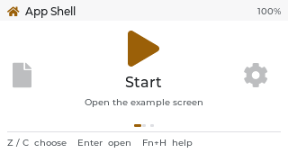

# Start from the reusable App Shell

The shell is a small native Cardputer Zero sample with three destinations:
**Start**, **Settings** and **About**. Its purpose is to give you a working
launch point, not to make you reverse-engineer Tick & Bell or adopt a particular
menu design. The carousel is my preference and a demonstration, not an M5Stack
requirement. A direct list may suit your app better.

The screenshot shows the simulator’s sample 100% battery value, not a hardware reading.

Keep the shell repo's README next to you for commands. This page is the source
of truth for how the pieces fit, what to customize, and what to verify.

## Start without extra moving parts

1. Run the unchanged shell in the desktop simulator. Move left from Start
   to About and right back to Start. Open each destination with Enter.
   Esc returns without losing the selected item. Open the help screen and
   return to the page you were on.
2. Change one title and its description in `src/app/starter_ui_layout.h`. Save with watch mode running
   and check the longest text you plan to use in both themes. Keep home labels
   brief; explanations belong on the destination screen.
3. Change the example content on the Start page, then add your useful first
   action. Keep selection/key routing and rendering separate. Don't introduce
   a service, Python or a device peripheral unless your app needs one.

## Preview changes as you work

Run the README's simulator watch command after configuring a desktop build.
On macOS and Linux, watch mode rebuilds changes to
`src/app/starter_ui_layout.h` and applies them in the same window. The shell
keeps the current page, selected row, scroll position, unsaved form values, and
the active field's text and cursor. An unsuccessful build leaves the last working
preview open; fix the error and save again.

Keep application state, timers and global input callbacks in the host code.
A visual rebuild is for layout, labels and rendering, not for changing the
running app's data model or input handling. Edits outside the layout file are
built but only take effect after you close and rerun the preview. That also
applies to all changes on Windows. There is no automatic restart. Close the
window or press Ctrl+C to stop watching. The handheld app does not use Python
or load preview modules.

The FPS, CPU and frame-time overlay is **off by default**, so it does not cover
the app. If you are profiling, run your desktop configure command with
`-DSIMULATOR_PERF_OVERLAY=ON` and rebuild. Use `-DSIMULATOR_PERF_OVERLAY=OFF`
to restore the clean preview. This setting has no effect on the device build.

## Know which files you own

| Where | What it controls |
| --- | --- |
| `src/app/starter_ui_layout.h` | The visual layout, menu labels, and destination content; this file hot-reloads in the desktop preview. |
| `src/app/starter_ui.h` | Navigation, form drafts, and the app's use of the official key router. |
| `src/app/starter_navigation.h` | Which destination is open, wraparound and what Back and Help do. The small navigation test does not depend on hardware. |
| `src/shared/home_menu.h` | The reviewed, vendored copy of the guide's [home-menu component](../examples/ui-patterns/carousel-position/README.md). The guide owns the pattern, including typography, battery and keyboard hints. |
| `src/shared/page_shell.h` | Reusable theme tokens, font roles, fixed page header/footer, and a keyboard-scrolled list. Visual defaults are a starting point. |
| `src/platform/linux_input.cpp` and `keyboard_decoder.*` | The Template’s evdev path with the reviewed extension for text and the official device keymap. Apps using the official shared runtime should not decode its keys again. |
| `app-identity.cmake` | Visible name, unique Debian package/launcher ID, version and maintainer. Start with a fresh build directory after changing identity. |
| `cmake/cm0-package.cmake` | Package and launcher layout. Learn what it installs before adding any startup behavior or permissions. |

The official CardputerZero Template still owns display startup, platform
key mapping, screenshot handling and the theme preference flow. The shell
uses that foundation and swaps in its own foreground UI. The app supplies a
measured battery percentage to the shared home menu when one exists; the
desktop value is simulated. Never invent a reading when the device is missing one.

## Use the page and keyboard building blocks

The shell repo is the buildable library. This guide documents what the pieces
do and which choices are optional. Use a fixed header and footer with a clipped
content region, shared light/dark colors, and one font role per job: 10 px
secondary text, 12 px body and controls, and 16 px section titles. The
**About** list demonstrates selection, wrapping and a position indicator that
appears only on overflow.

- **Explanation rows (NFC Tools):** Put a title on the first line and a short,
  muted explanation beneath it. Keep the unchanged NFC-style selected fill,
  6 px corners, and left accent stripe. A chevron marks a row that opens a page.
- **Settings rows (Mesh):** Put the setting name on the left and its current
  value on the right, on one line. Keep values as text; a boolean can simply
  read **On** or **Off**. Don’t add a chevron to an inline setting or a read-only
  value. The shell’s **Settings** page demonstrates this.

Use F/X or Up/Down to move through either kind of list. Wrap at the ends,
keep the selected row visible, and leave the header and footer stationary.
These are the shell’s defaults, not Cardputer Zero requirements.

### Form Save and Back

The **Start** page is a five-field example with a fixed title and footer.
Only the fields move. **Category** shows optional helper text beneath its label
while keeping its value right-aligned. Add a short `ListItem::helper` string
only when a field needs explanation; leave it empty for a one-line row.

The form footer says **1 save form**; the field editor
says **Enter keep field**. These are separate actions.

1. Enter opens a field. While editing, digits and letters belong to the
   field. Pressing **1** must never save the form from inside an editor.
2. **Enter** keeps just that field in the form draft. **Esc** cancels just
   that edit and leaves the rest of the draft unchanged. Fn+H can show Help
   without losing the text or cursor.
3. From the form, **1** saves the whole draft. The example only saves for
   the current run. A real app validates and confirms its storage operation
   succeeded before it marks a draft saved.
4. **Esc** goes back without a prompt when there are no unsaved changes.
   When the draft is different from the last saved state, ask before
   discarding. Select **Keep editing** by default, and treat Esc on the
   prompt as Keep editing. Discard needs an explicit selection and Enter.
   A held key must not accept a prompt it just opened.

The shared `src/shared/form_draft.h` keeps the saved values and form draft
separate. A dedicated field editor uses a small local buffer so cancel does
not touch either one. This sets the save/back contract, not the layout or
validation rules for every possible form. See the [keyboard chapter](05-keyboard.md)
for key mapping and context ownership.

## Make a package that can sit beside the sample

Pick a different lowercase package ID and visible name in
`app-identity.cmake`, then configure in a new build directory. The ID becomes
the executable, launcher filename, icon name and preferences directory. Verify
all four change, not just the title. Using a unique ID prevents your test
package from replacing another app or reusing its preferences.

Start with the [building and packaging chapter](06-building-and-packaging.md)
for dependencies and [the first-device walkthrough](first-device-app.md) for
copying the package, verifying installation, upgrading and removing a test app.
The shell is not a Store listing. Use [Store readiness](store-readiness.md)
only when you are actually preparing a submission.

## Check the result

- In both themes, confirm text reads comfortably at 320×170, the dot follows
  selection in both directions, and the displayed shortcuts work.
- Open a destination, return, and confirm selection is retained. Test Help and
  exit from home. Close and reopen to verify the saved theme.
- Inspect the arm64 package for the expected identity and launcher path.
  Then test the physical keypad and display on the intended Cardputer Zero.
  A simulator run does not qualify those checks.

If the simulator works but the installed app does not, start with
[device app troubleshooting](device-app-troubleshooting.md). For a fuller
example with its own scheduler, see [Tick & Bell](case-studies/tick-bell.md).
