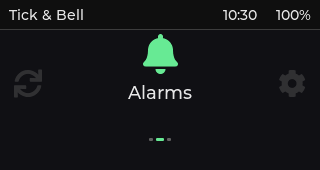
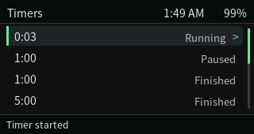
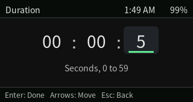
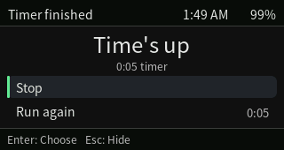
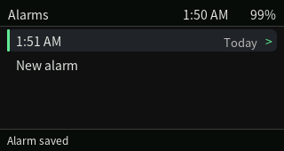
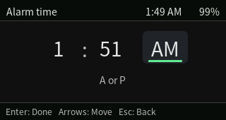
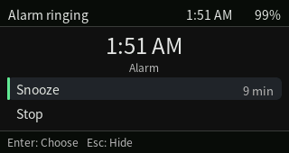

# Tick & Bell: timers and alarms

[Browse the Tick & Bell source on GitHub](https://github.com/Prophet60191/m5stack-cardputer-zero-tick-bell)

Tick & Bell is a native timer and alarm for the Cardputer Zero. It is a
worked example to read alongside the guide, not an official M5Stack Store app.

## Home menu

The centered icon and title identify the selected menu. Side icons show nearby
choices and the wider dot marks position without relying on color. Left/Right
changes the home selection; Up/Down moves through submenu rows.
See the [shared home menu](../../examples/ui-patterns/carousel-position/README.md).

## Timers and alarms

| Timers | Typing a duration | Timer finished |
| --- | --- | --- |
|  |  |  |

| Alarms | Typing a time | Alarm ringing |
| --- | --- | --- |
|  |  |  |

From 0.1.6 the lists lead with the time and show what exists before the
New row. Space pauses or resumes the selected timer, or switches the selected
alarm on or off; Del removes it after a Cancel-first confirmation. A new timer
or alarm opens on one typed field (5 for five minutes, 7 3 0 for 7:30), and
finishing it lands on the form's Start or Save row. An alarm's **When** is one
choice of once, weekdays or a date, and opening an alarm from the list opens
its form. A ringing alarm offers Snooze first, so a stray Enter cannot cancel
a wake-up. Settings chooses a 12-hour or 24-hour clock for the header and
every alarm time.

These six captures were read from the handheld's own 320×170 screen while
version 0.1.6 ran against its scheduler; the timer and alarm shown did ring.
Keys were sent through the keyboard's input device by a script, not pressed
by hand, and both test items were silent. The home capture above is an
earlier desktop render.

## Upgrade and rollback

The [worked update](../upgrade-existing-app.md) shows how to stop and back up
the scheduler, verify the installed and running binaries, and check that a
saved alarm survives an upgrade and a rollback. If the timer’s window itself
won’t open, start with [the launcher and library checks](../device-app-troubleshooting.md#the-icon-is-there-but-the-app-closes-immediately) before changing scheduler settings.

## Where the patterns came from

- **Official M5Stack foundation:** the pinned CardputerZero Template and LVGL
  supply rendering, device status and input routing.
- **Adapted:** NFC Tools provides the center group, side icon lanes, icon sizes
  and dot placement, along with the header, subtitle and keyboard footer.
- **Added here:** a reusable header separates the presentation from
  navigation, so apps bring their own glyphs and labels. A user-session
  scheduler keeps alarms active after the window closes; it does not wake a
  powered-off or suspended device.

[Clock-core tests](https://github.com/Prophet60191/m5stack-cardputer-zero-tick-bell/blob/main/integration/clock_core_test.cpp)
cover scheduling and persistence separately from the interface. Simulator
captures, scripted key input and native packaging do not substitute for
physical keypad, speaker or suspend checks.
