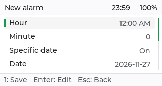
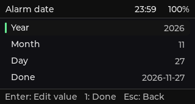
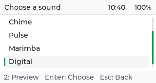

# Tick & Bell: timers and alarms

[Browse the Tick & Bell source on GitHub](https://github.com/Prophet60191/m5stack-cardputer-zero-tick-bell)

Tick & Bell is a native timer and alarm for the Cardputer Zero. It is a
worked example to read alongside the guide, not an official M5Stack Store app.

## Home menu

The centered icon and title identify the selected menu. Side icons show nearby
choices and the wider dot marks position without relying on color. Left/Right
changes the home selection; Up/Down moves through submenu rows.
See the [shared home menu](../../examples/ui-patterns/carousel-position/README.md).

## Alarms and sounds

| Next-hour default | Date selector | Sound picker |
| --- | --- | --- |
|  |  |  |

At a simulated 11:59 PM, a new alarm defaults to midnight and advances to
the next date. These 320×170 desktop captures use synthetic data; the
simulator battery value is not a device measurement.

## Upgrade and rollback

The [worked update](../upgrade-existing-app.md) shows how to stop and back up
the scheduler, verify the installed and running binaries, and check that a
saved alarm survives an upgrade and a rollback.

## Where the patterns came from

- **Official M5Stack foundation:** the pinned CardputerZero Template and LVGL
  supply rendering, device status and input routing.
- **Adapted:** NFC Tools provides the center group, side icon lanes, icon sizes
  and dot placement, along with the header, subtitle and keyboard footer.
- **Added here:** a reusable header separates the presentation from
  navigation, so apps bring their own glyphs and labels. A user-session
  scheduler keeps alarms active after the window closes; it does not wake a
  powered-off or suspended device.

[Clock-core tests](https://github.com/Prophet60191/m5stack-cardputer-zero-tick-bell/blob/main/integration/clock_core_test.cpp)
cover scheduling and persistence separately from the interface. Simulator
captures and native packaging do not substitute for physical keypad, speaker
or suspend checks.
