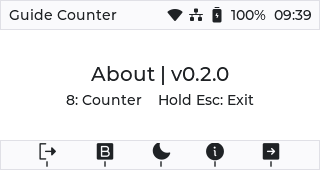
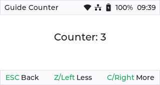

# First device app: install and update a saved counter

This optional exercise follows the [simulator counter](first-app.md). It uses the
same official Template and adds a separate app, **Guide Counter**, with two pages:
**About** and **Counter**. It stores one number. It needs no Cap, service, network
access at runtime, or Store account. This is a teaching package, not a Store
submission. The unmodified Template package from the first tutorial is not the
package to install here.





Desktop simulator captures using the [official Template](https://github.com/CardputerZero/Template) (MIT), not photos of the device.

**Official:** Template display, input, assets and Debian packaging foundation.
**Guide contribution:** the independently named saved counter patch, its two
teaching versions, and the install/upgrade/rollback tests. Neither version
is an official Template release.

**Why extend the official route?** Template and AppBuilder explain how to build and package. This exercise connects those commands to a first real install, a launcher check, and an update with data to protect. A separate package name avoids overwriting a Template app. Two versions deliberately keep the same saved format so the reader can distinguish a working install from a safe update and rollback.

## 1. Build both versions and inspect the packages

Use the [demo source and build recipe](../examples/counter-demo/README.md).
Build version 0.1.0 and version 0.2.0 in separate build directories. Keep both
packages. Use the desktop simulator to find About and Counter if this is your
first build, but use the **arm64 Debian packages** for the rest of this page.

From a directory containing just the two artifacts, inspect each one before
copying it to the handheld:

```sh
for file in ./*.deb; do
    dpkg-deb -f "$file" Package Version Architecture Depends
    dpkg-deb -c "$file"
    sha256sum "$file"
done
```

Both should report the same package name, `cp0-guide-counter-demo`, and
architecture `arm64`, but different versions. Check that the launcher entry,
executable, and shared launcher icon have demo-specific names. This demo
should not install a service. A package built for the desktop or with the old
Template identity is not interchangeable. Save the hashes so you can tell which
files you tested. If macOS lacks these tools, run this check in the Debian build
environment.

## 2. Install version 0.1.0 and try the physical keys

Use a spare microSD already running a supported Cardputer Zero image, or a
device you have permission to change. Flashing a card erases its contents;
nothing in this exercise requires rewriting a working card. Copy the two exact
packages to a new folder in your home directory using your normal transfer
method. On the device, verify the copied hashes and check for a collision:

```sh
dpkg --print-architecture
dpkg-query -W -f='${db:Status-Abbrev} ${Version}\n' cp0-guide-counter-demo
```

Expect `arm64`. On a first install the second command should report that no
package matches. The state file is named in step 3. If you find an existing package or leftover demo state,
do not install over it blindly. Use a fresh test account or a spare card, or
deliberately preserve that earlier copy first.

Open a device terminal in the folder with both packages. For each install command
below, use the exact file from step 1 and keep the leading `./`. Use `apt` for the package install, but launch the app as your ordinary user,
not with `sudo`.

```sh
sudo apt install ./cp0-guide-counter-demo_0.1.0_rev1_arm64.deb
dpkg-query -W -f='${Version}\n' cp0-guide-counter-demo
```

If APT proposes removing other packages or changing unrelated installed packages,
answer **No** and check [the troubleshooting page](device-app-troubleshooting.md).
Return to the launcher and open **Guide Counter**. Check the version in **About**.
Press **8** to open **Counter**, then **C/Right** to add one and **Z/Left** to
subtract one. Tap **Esc** to go back; hold **Esc** on About to exit to the launcher.
Set the count to **3**, close the app, and reopen it. It should still show **3**.
That last check uses a new process; switching screens alone would not test saving.

## 3. Upgrade without losing the count

Exit the app before installing a different version. Record the current count,
then copy the demo's state file to a new private backup. Run these as the same
ordinary user who opened the app:

```sh
state="${XDG_STATE_HOME:-$HOME/.local/state}/cp0-guide-counter-demo/count"
test -f "$state" && backup=$(mktemp "$HOME/guide-counter-backup.XXXXXX") &&
    cp -- "$state" "$backup" && printf 'Demo backup: %s\n' "$backup"
```

If the file is missing or the backup fails, stop and find out why before
upgrading. Keep the old package and backup. The app owns only this one number;
there is no schema migration in this exercise.

```sh
sudo apt install ./cp0-guide-counter-demo_0.2.0_rev1_arm64.deb
dpkg-query -W -f='${Version}\n' cp0-guide-counter-demo
```

Launch from the menu again. Check that **About** shows 0.2.0 and **Counter** still
shows **3**. Add one, close, reopen, and check **4**. The version check and the
saved-count check answer two different questions: whether you are running the
new app, and whether it kept your data.

For a worked upgrade of an app with a background writer, see
[Update an existing app without losing its data](upgrade-existing-app.md).

## 4. Roll back the app, then remove it

Exit the demo. Back up its current count separately using the step 3 command if you want to keep it.
This tutorial's older build reads the same file format, so no restore should be
needed. Ask APT first what the downgrade would do:

```sh
apt -s install --allow-downgrades ./cp0-guide-counter-demo_0.1.0_rev1_arm64.deb
```

Only if it proposes the demo downgrade and no unrelated changes, repeat with
`sudo apt install --allow-downgrades` (without `-s`; do not add `-y`).
Launch it again, verify **0.1.0** and **4**, and then exit. A real application
might change its file format; retaining an older package does not by itself make
downgrading its data safe. If this demo fails to reopen, keep both saved copies
and diagnose before restoring anything.

Use `apt -s remove cp0-guide-counter-demo` to preview removal; proceed with
`sudo apt remove cp0-guide-counter-demo` only if the demo is the sole removal.
Verify the launcher entry is gone and the user-owned state file still exists.
The package manager should not erase your home-directory data. Leave that
file in place unless you deliberately want to delete the exercise data.

## What to record

Note the image version, both package hashes, and which steps you performed:
install, first launch, physical keys and exit, restart, upgrade, rollback, and
removal. A desktop or container run is valuable but does not certify the physical
screen, keys, or launcher. Mark those checks pending unless you performed them
on a real device. See [the recorded checks](../examples/counter-demo/verification.md). A second person following the instructions unaided is a
separate [reader check](first-reader-check.md).

[Symptom-first troubleshooting](device-app-troubleshooting.md) ·
[Packaging reference](06-building-and-packaging.md)
