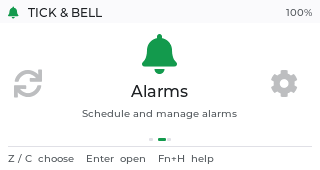

# Reusable NFC Tools-style home menu

A carousel is a matter of preference. I like this layout, so I use it in my
apps and as a demonstration in this guide. It is not an official M5Stack
requirement or a recommendation for every app. For a long list of destinations
or a frequent scanning task, a simple vertical list may be faster to use.



Desktop simulator capture, not a hardware photo. The simulated 100% is the
Template's desktop sample battery value.

## The 320×170 visual standard

| Component | NFC Tools reference |
| --- | --- |
| Header | 23 px high; a 12 px app glyph at (8, 5) and 12 px app name at (28, 5). Show the device-reported battery as right-aligned plain text inside the right margin. Hide it when unavailable. |
| Center menu | 216×105 group at (52, 32); 40 px centered symbol at screen y=33, 16 px title at y=82 and muted 10 px subtitle at y=108. |
| Neighbors | 28 px symbols at 40% opacity in 37 px lanes at x=14 and x=270, starting at y=69. |
| Dots | At y=138 with 9 px pitch; the selected 8×3 pill starts at its slot's fixed edge, and the other dots are 4×3. One slot per destination; no dots for zero or one item. |
| Footer | Thin divider from x=8 to x=311 at y=146; muted 10 px keyboard hints at (8, 153). The printed keys must actually work. |
| Motion | A 46 px directional slide and 180 ms fade on the center group. The side lanes, dots, header and footer stay fixed. Keep direction through wraparound; do not animate a theme change or initial paint. |

App content remains app-specific: titles, descriptions, glyphs and colors can
change without adjusting the standard's geometry or typography. This is a home
page component, not a rule for submenus or the official launcher.

## Use the component

[home_menu.h](home_menu.h) is a presentation-only MIT header for LVGL 9.
It uses enabled Montserrat fonts at 10, 12, 16, 28 and 40 px. Create it on a
dedicated full-screen parent with no padding. Do not put it on a screen that
uses a different content origin.

```cpp
auto home = cp0_ui::HomeMenu::create(root, palette, item_count,
    LV_SYMBOL_HOME, "MY APP", "Z / C  choose    Enter  open");
home.set_item(index, previous_icon, current_icon, next_icon, title, subtitle);
home.set_battery(device_percent);  // use -1 when not available
home.animate(direction);
```

The app still owns navigation, focus, battery reads, theme selection and
screen lifetime. Call `set_palette` for light/dark changes without resetting
selection. LVGL owns the created widgets. Drop the handle before cleaning or
deleting its parent. For more than 24 destinations, choose another
presentation rather than squeezing in more dots.

[carousel_layout.h](carousel_layout.h) and [carousel_position.h](carousel_position.h)
are the earlier geometry-only and indicator-only examples. They remain
available for apps that intentionally do not want the complete menu.

## Where it came from

- **Official foundation:** LVGL and the CardputerZero Template provide
  rendering, the keyboard entry points and device-status conventions.
- **Adapted design:** NFC Tools' rendered home page is the reference for
  header, footer, typography, center layout, shaded neighbors and dots.
- **Added here:** The standalone component separates that appearance from app
  state. The shared header shows a real battery percentage, with no glyph.

See [Tick & Bell](../../../docs/case-studies/tick-bell.md) for a worked example.
Compare actual renders in both themes, including the same title or icon when
possible. Check wraparound, footer shortcuts and unavailable battery separately.
